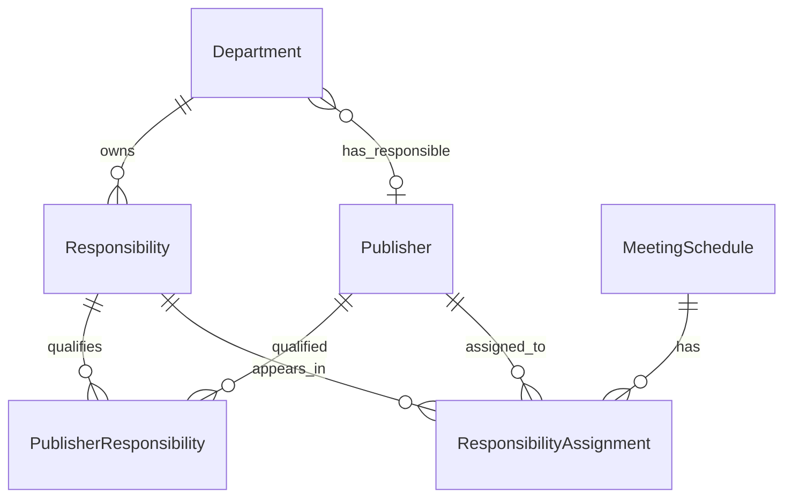

# Gestor Teocrático

[](https://dotnet.microsoft.com/)
[](https://www.postgresql.org/)
[](https://blazor.net/)
[](https://tailwindcss.com/)
[](https://www.docker.com/)
[](LICENSE)

> A web application to manage a religious congregation: publishers, departments,
> responsibilities, and the weekly meeting schedule — built with ASP.NET Core Blazor Server,
> PostgreSQL, and Blazor Blueprint.

---

## Overview

**Gestor Teocrático** streamlines the operational organization of a congregation: it keeps a
directory of publishers with their privileges and qualifications, organizes departments and their
responsibilities, and schedules who serves in each meeting week by week — then exports the monthly
schedule as a PDF.

Users sign in with **Google** (an optional local "break-glass" admin account is available for
environments without Google). The app models a **single congregation**.

- **Centralized management** of publishers, departments, responsibilities, and schedules.
- **Role-based access** (`Admin`, `Manager`, `User`).
- **Safe assignment**: only publishers qualified for a responsibility can be assigned; one
  publisher per responsibility per meeting.
- **Printable output**: A4-landscape monthly schedule in PDF.
- **Data safety**: soft delete for congregations, departments, publishers, and responsibilities.

---

## Tech Stack

| Concern | Technology |
|---|---|
| Runtime / web | **.NET 10**, ASP.NET Core, Blazor Server (interactive server render mode) |
| UI | **Blazor Blueprint v4** (`Bb*` components) + Lucide icons |
| Styling | **Tailwind CSS v4** (npm) with shadcn-style CSS variables; light/dark theme |
| ORM / database | EF Core 10 + **PostgreSQL 17** (`Npgsql.EntityFrameworkCore.PostgreSQL` 10) |
| Auth | ASP.NET Core Identity + **Google OAuth** |
| Data protection | ASP.NET Data Protection keys persisted in the database |
| PDF | **QuestPDF** 2025.7.0 |
| Email | **Resend** 0.1.5 (optional; no-op sender otherwise) |
| Tooling | Docker / Docker Compose, GitHub Actions |

> Radzen, Bootstrap, and the previous .NET 9 stack have been **removed**. See the git history for
> the Blazor Blueprint migration.

---

## Architecture (high level)

A single ASP.NET Core project (`GestorTeocratico/`) organized by **feature**:

```
GestorTeocratico/
├── Components/     # Blazor UI: Account, Layout (shell), Pages (features), Ui
├── Features/       # Vertical slices per domain (Shared/ + one folder per use case)
│   ├── Common/     # Shared domain exceptions
│   ├── Congregations/ Departments/ Publishers/ Responsibilities/
│   ├── MeetingSchedules/ (+ Endpoints/)   # schedules + responsibility assignments
│   ├── PdfExport/ (+ Models/)
│   └── Roles/
├── Data/           # ApplicationDbContext, ApplicationUser, seeders, Migrations/
├── Entities/       # Domain models (SoftDeleteEntity)
├── Services/       # ResendEmailSender, ResendOptions
├── Shared/         # Roles.cs, Enums/
├── wwwroot/        # Tailwind input/output CSS, theme, images
└── Program.cs      # Composition root (DI, auth, pipeline, seeding, endpoints)
```

- Handlers (and the remaining services) use `IDbContextFactory<ApplicationDbContext>` (one
  short-lived context per operation), which keeps long-lived Blazor Server circuits safe under
  concurrency. Read models are DTOs; EF entities are never exposed to the UI.
- Soft-deletable entities are excluded from queries by global EF query filters.
- Full details: [`docs/ARCHITECTURE.md`](docs/ARCHITECTURE.md).

---

## Getting Started

### Prerequisites

- **.NET SDK 10.0+**
- **Node.js + npm** (Tailwind)
- **PostgreSQL 17** (or Docker)
- **Docker / Docker Compose** (recommended)

### Quick start with Docker

```bash
git clone https://github.com/r3garciaz/GestorTeocratico.git
cd GestorTeocratico

cp .env.example .env      # set DB credentials, Google OAuth, emergency admin

docker compose up --build
# App: http://localhost:8080     DB: host port 54332
```

### Local development

```bash
npm install                        # Tailwind tooling

cp .env.example .env               # adjust values

dotnet restore
dotnet ef database update --project GestorTeocratico   # optional; runs at startup too
dotnet run --project GestorTeocratico
# https://localhost:7095 | http://localhost:5265
```

Migrations and seed data are applied automatically at startup (development seeds sample data).

### Styling

```bash
npm run watch:css    # during development
npm run build:css    # minified output to wwwroot/css/app.css
```

### Sign in

There is **no default username/password**. Access is via **Google sign-in** on `/Account/Login`.
The **first account created becomes Admin**. For environments without Google, configure
`EMERGENCYADMIN__EMAIL` / `EMERGENCYADMIN__PASSWORD` and use the local login form.

---

## Configuration

`appsettings.json` contains only logging defaults; configure via environment variables (or user
secrets). See [`.env.example`](.env.example) and [`docs/DEVELOPMENT.md`](docs/DEVELOPMENT.md).

| Variable | Required | Purpose |
|---|---|---|
| `ConnectionStrings__DefaultConnection` | ✅ | Npgsql connection string |
| `ASPNETCORE_ENVIRONMENT` | ✅ | `Development` / `Production` |
| `AUTHENTICATION__SCHEMES__GOOGLEOIDC__CLIENTID` | ✅ | Google OAuth client id |
| `AUTHENTICATION__SCHEMES__GOOGLEOIDC__CLIENTSECRET` | ✅ | Google OAuth client secret |
| `RESEND__APITOKEN` | ❌ | Email sending (falls back to no-op) |
| `RESEND__FROMEMAIL` | ❌ | Email "from" address |
| `EMERGENCYADMIN__EMAIL` / `EMERGENCYADMIN__PASSWORD` | ❌ | Break-glass local admin |

When running the DB via Docker Compose, the host port is **54332** (not 5432).

---

## Data Model

Core entities: `Congregation`, `Department`, `Publisher`, `Responsibility`, `MeetingSchedule`,
plus the join entities `PublisherResponsibility` (qualified publishers) and
`ResponsibilityAssignment` (assigned publisher for a meeting/responsibility).



- Congregation is a **singleton** (enforced in code).
- `SoftDeleteEntity` (`IsDeleted`) is used by Congregation, Department, Publisher, Responsibility;
  global query filters hide deleted rows.
- Keys are UUIDv7 (`Guid.CreateVersion7()`), except join tables (composite keys) and Identity.

Full schema, keys, and soft-delete behavior: [`docs/DATA-MODEL.md`](docs/DATA-MODEL.md).

---

## API

The only HTTP endpoint today is the PDF export:

```http
GET /api/meeting-schedules/monthly-schedule/{year}/{month}
```

Returns `application/pdf` (`Programacion_{Mes}_{Year}.pdf`); `year` 2020–2030, `month` 1–12.
See [`docs/API.md`](docs/API.md). There is **no REST/JWT API**.

---

## Documentation

| Document | Contents |
|---|---|
| [`AGENTS.md`](AGENTS.md) | Operating manual for AI coding agents (rules, commands, recipe) |
| [`docs/README.md`](docs/README.md) | Documentation map |
| [`docs/ARCHITECTURE.md`](docs/ARCHITECTURE.md) | Composition, DI, render modes, pipeline |
| [`docs/DATA-MODEL.md`](docs/DATA-MODEL.md) | Entities, relationships, soft delete, migrations |
| [`docs/FEATURES.md`](docs/FEATURES.md) | Handler/page/endpoint map and business rules |
| [`docs/UI-GUIDE.md`](docs/UI-GUIDE.md) | Blazor Blueprint + Tailwind conventions |
| [`docs/AUTH.md`](docs/AUTH.md) | Google OAuth, Identity, roles, claims |
| [`docs/DEVELOPMENT.md`](docs/DEVELOPMENT.md) | Setup, env vars, migrations, seeding, Docker, CI |
| [`docs/API.md`](docs/API.md) | HTTP endpoints |
| [`docs/CONVENTIONS.md`](docs/CONVENTIONS.md) | Coding standards |
| [`docs/TESTING.md`](docs/TESTING.md) | Test project, strategy and scenarios |
| [`docs/TROUBLESHOOTING.md`](docs/TROUBLESHOOTING.md) | Known pitfalls and fixes |
| [`docs/PRD.md`](docs/PRD.md) | Product requirements |
| [`docs/ROADMAP.md`](docs/ROADMAP.md) | Status and next steps |

---

## Contributing

- Follow the conventions in [`docs/CONVENTIONS.md`](docs/CONVENTIONS.md) and [`AGENTS.md`](AGENTS.md).
- Conventional Commits with Spanish subjects (e.g. `feat(ui): ...`).
- Branch names: `feat/...`, `fix/...`, `refactor/...`, `docs/...`.
- Update the relevant doc under `docs/` when behavior, routes, schema, or config change.
- Tests live in [`GestorTeocratico.Tests`](GestorTeocratico.Tests) — run `dotnet test`; see
  [`docs/TESTING.md`](docs/TESTING.md).

```bash
dotnet build
dotnet test
npm run build:css
```

## License

MIT — see [`LICENSE`](LICENSE).

---

*Gestor Teocrático — keeping congregation administration organized and printable.*
